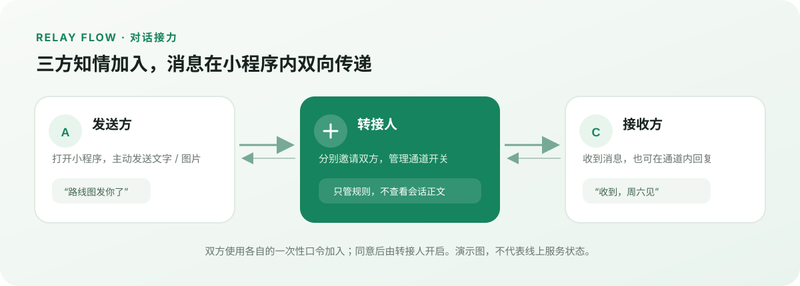
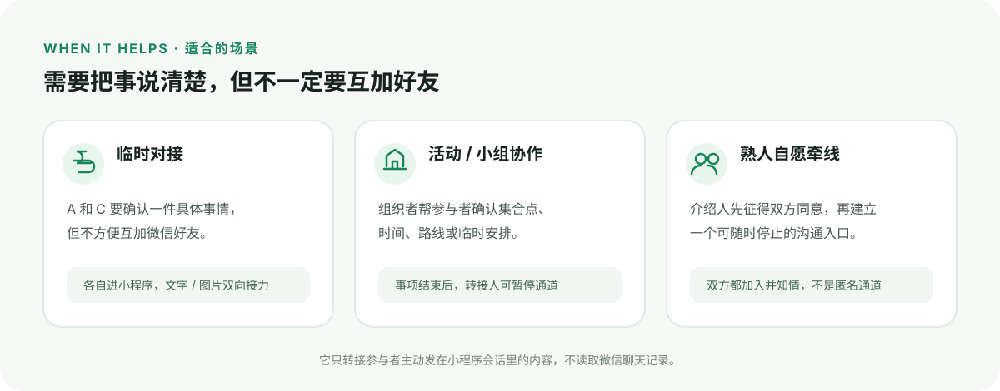

# 对话接力

> 三个人先讲清楚、都同意，再把小程序里发送的文字和图片双向接到对方。

**当前定位：熟人小范围体验版。** 它不是微信聊天记录读取器，也不能自动监听或转发微信聊天窗口里的消息。发送方和接收方需要在小程序的转接会话里主动发消息。

## 对话怎么接起来



```text
发送方  ⇄  CloudBase 转接通道  ⇄  接收方
                    ↑
          转接人创建规则、邀请成员、管理开关
```

转接人创建一条独立通道，分别把发送方口令和接收方口令私下发给两位参与者。两人加入并同意后，转接人开启通道；此后双方在小程序里发出的文字或图片会送到对方，回复也会反向送回。转接人负责管理规则，不在小程序会话页查看消息正文。

## 适合的使用场景



- **A 和 C 需要临时交流，但不方便互加微信好友：** 转接人分别邀请两人进入同一条通道，A、C 在小程序会话里发文字或图片，消息双向转接。适合只需沟通一件具体事情、希望少交换联系方式的情况。
- **活动或小组的临时对接：** 组织者作为转接人，帮助参与者确认集合地点、时间或路线，结束后可暂停通道。
- **熟人牵线的短期沟通：** 介绍人先确认双方都愿意，再建立通道，让双方自行决定是否继续联系。

使用前提：转接人、发送方和接收方都需要知情并同意；发送方和接收方要分别打开小程序、使用各自的一次性口令加入。它不是匿名聊天或绕过微信好友机制的工具，也不会读取、监听或转发微信原生聊天窗口中的消息。请勿用于紧急联络、敏感信息或需要长期保存的沟通。

## 现在能做什么

- 一个转接人可以创建和管理多条独立通道。
- 发送方、转接人、接收方各自确认后才能开始；转接人可以暂停或恢复单条通道。
- 邀请口令按席位生成、只能使用一次，24 小时后过期。
- 会话支持文字和图片；文字最多 500 字。图片选择界面目前限制为 10 MB。
- 网页演示版可在浏览器中模拟三种角色；它只在当前浏览器里演示，不连接 CloudBase，也不会上传消息或图片。

## 安全与数据边界

- 云函数通过当前微信用户身份（OpenID）校验通道成员和管理权限。
- 文字在写入数据库前使用 AES-256-GCM 加密；密钥从 CloudBase 云函数环境变量 `RELAY_ENCRYPTION_KEY` 读取，不应提交到仓库。
- 图片保存在 CloudBase 云存储；读取消息时，云函数先校验成员，再返回临时图片链接。
- 消息和图片按 31 天过期策略清理；仓库包含每小时运行的清理触发器配置，部署后还需在 CloudBase 确认触发器已启用。
- **目前的限制：** 10 MB 图片限制只在前端检查，后端还需补充文件大小、真实类型和内容安全校验；清理函数删除消息和图片，但不会删除通道记录及其中的成员 OpenID。公开长期使用前，应补上通道删除、撤回同意和完整的数据清理能力。
- 测试时请只邀请知情并同意的参与者，不要发送身份证件、账号密码、支付信息等敏感内容。

## 快速开始

1. 用微信开发者工具导入仓库根目录。
2. 在 `miniprogram/config.js` 配置自己的 CloudBase 环境 ID；确认 `project.config.json` 中的 AppID 与小程序一致。
3. 在 CloudBase 部署 `relay` 和 `cleanup` 云函数，给 `relay` 配置服务端环境变量 `RELAY_ENCRYPTION_KEY`。
4. 确认云数据库包含 `relayChannels`、`relayMessages`、`relayUploads` 集合，并在控制台启用 `cleanup` 的每小时定时触发器。
5. 用三个不同微信账号分别测试转接人、发送方和接收方：创建通道、分别发送口令、加入并确认，再由转接人开启通道。

只想看界面时，直接用浏览器打开根目录的 `index.html` 即可。它是本地模拟，不代表云端链路已部署成功。

## 项目结构

- `miniprogram/`：小程序页面、会话界面和 CloudBase 调用封装
- `cloudfunctions/relay/`：通道、邀请、权限、文字和图片消息接口
- `cloudfunctions/cleanup/`：过期消息与图片清理
- `docs/images/`：README 使用的本地 SVG 演示图
- `index.html`：浏览器本地交互演示
